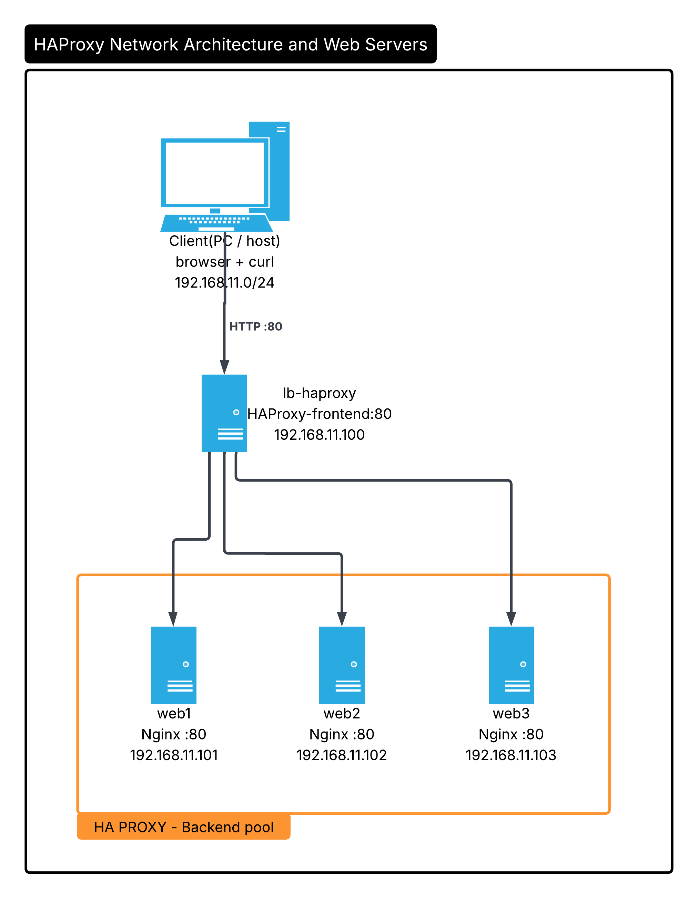

# HAProxy Load Balancer Lab

Hands-on HAProxy load balancing lab on VMware: Round Robin, Least Connections, Weighted balancing, health checks and failover testing across three Ubuntu Server web backends.

## About the project

This project builds a complete load balancing lab from scratch, using only free tools. A client sends HTTP requests to an HAProxy load balancer, which distributes them across three Nginx web servers and automatically stops using a server that fails.

It is written as a step-by-step training: every command and configuration line is explained, every result is verified with screenshots, and the final chapters add troubleshooting exercises and a presentation scenario.

## What the lab covers

- Load balancing concepts: reverse proxy, frontend, backend, high availability, fault tolerance
- Preparing four Ubuntu Server virtual machines with static IP addresses
- Nginx web servers that identify themselves in every response
- HAProxy configuration with Round Robin, Least Connections and Weighted Round Robin
- Verifying the distribution from three angles: the client, the HAProxy logs and the statistics page
- HTTP health checks, a server failure test and automatic recovery
- A diagnostic method and five hands-on exercises with explained solutions
- A realistic scenario to present the project to a jury

## Architecture



| Machine | Hostname | IP address | Software |
|---|---|---|---|
| Load balancer | `lb-haproxy` | 192.168.11.100 | HAProxy |
| Web server 1 | `web1` | 192.168.11.101 | Nginx |
| Web server 2 | `web2` | 192.168.11.102 | Nginx |
| Web server 3 | `web3` | 192.168.11.103 | Nginx |

- Network: `192.168.11.0/24`, gateway `192.168.11.1`, VMware bridged mode
- Each web server uses 1 GB of RAM, so the lab fits comfortably on a 16 GB computer

## Requirements

- A computer with 16 GB of RAM
- VMware (Workstation or Player)
- Ubuntu Server LTS ISO
- No paid software: HAProxy, Nginx and Ubuntu Server are free and open source

## Documentation

Follow the documents in order.

| # | Document | Content |
|---|---|---|
| 01 | [Concepts](docs/01-concepts.md) | Load balancing, reverse proxy, frontend, backend, high availability, fault tolerance |
| 02 | [Architecture](docs/02-architecture.md) | Machines, roles, IP plan, resources, lab versus production |
| 03 | [VM setup](docs/03-vm-setup.md) | Creating and configuring the VMs, Nginx, cloning, connectivity checks |
| 04 | [HAProxy configuration](docs/04-haproxy-config.md) | Installation, line-by-line configuration, the three algorithms |
| 05 | [Testing](docs/05-testing.md) | Verifying the distribution with headers, logs and the statistics page |
| 06 | [Health checks and failover](docs/06-health-checks-failover.md) | Health checks, failure test, recovery, application-level failure |
| 07 | [Troubleshooting](docs/07-troubleshooting.md) | Symptoms and the diagnostic ladder |
| 08 | [Exercises](docs/08-exercises.md) | Five incident exercises with solutions and a tuning measurement |
| 09 | [Jury scenario](docs/09-jury-scenario.md) | Scenario, timed plan, demonstration script, likely questions |

## Repository structure

```
haproxy-load-balancer-lab/
├── README.md
├── docs/                  Step-by-step documentation (01 to 09)
├── configs/
│   ├── haproxy/           HAProxy configurations
│   └── web/               Nginx configuration and test page
├── scripts/               Measuring script used in exercise 5
├── screenshots/           Evidence for each step
└── diagrams/              Architecture diagram
```

### Configuration files

| File | Description |
|---|---|
| `configs/haproxy/haproxy-roundrobin.cfg` | Round Robin, simple TCP health check |
| `configs/haproxy/haproxy-leastconn.cfg` | Least Connections |
| `configs/haproxy/haproxy-weighted.cfg` | Weighted Round Robin (weights 3, 2 and 1) |
| `configs/haproxy/haproxy-healthcheck.cfg` | HTTP health checks and the statistics page |
| `configs/haproxy/haproxy-final.cfg` | Final configuration: HTTP health checks, retries and redispatch |
| `configs/web/lab.conf` | Nginx settings that add the server name to every response |
| `configs/web/index.html` | Test page that displays the server name and IP |
| `scripts/measure.sh` | Sends requests for 30 seconds and logs the HTTP status of each |

The statistics page password in these files is a placeholder (`CHANGE_ME`). Use your own password in your lab.

## Key results

- **Distribution:** requests are shared across the three servers, equally with Round Robin and in proportion to the weights with Weighted Round Robin.
- **Verification:** the same distribution is confirmed by the response header, the HAProxy logs and the statistics page.
- **Failover:** when Nginx stops on one server, HAProxy detects it in a few seconds and keeps serving from the other two. The server returns to service by itself once it is back.
- **Application-level failure:** a server that keeps its port open but returns `403` is detected by the HTTP health check, which a simple TCP check would have missed.
- **Tuning:** in the measurement made in exercise 5, enabling `retries 3` and `option redispatch` left 0 of 129 requests failed during a server stop, against 2 of 111 without it. The sample is small, so the result is indicative.

## Lab versus production

| Aspect | This lab | Production |
|---|---|---|
| Load balancer | One HAProxy VM (single point of failure) | Two nodes with Keepalived and a virtual IP |
| Protocol | HTTP | HTTPS with certificates |
| Network | One flat network | Separated networks and firewalls allowing only the load balancer to reach the backends |
| Monitoring | Manual commands and the statistics page | Metrics, dashboards and alerts |
| Deployment | Manual configuration and cloning | Automated and version-controlled |

## Possible improvements

- A second HAProxy node with Keepalived
- TLS termination on port 443
- Firewall rules that allow port 80 on the backends only from the load balancer
- Session persistence for stateful applications
- Metrics with Prometheus and Grafana
- Automation with Ansible
