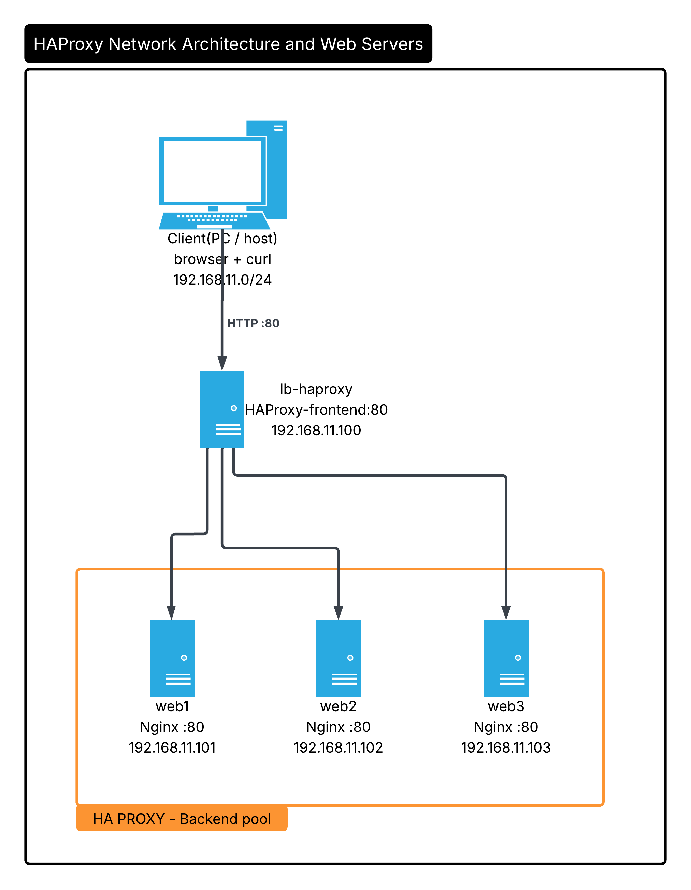

# 02 - Lab Architecture

This document describes the architecture of the HAProxy load balancing lab: the machines, their roles, the IP addressing plan, the resources allocated to each virtual machine and the path a request takes through the system.

## 1. Objectives

- Distribute incoming HTTP requests across three identical web servers using **HAProxy**.
- Compare balancing algorithms: Round Robin, Least Connections and Weighted Round Robin.
- Detect a failed server automatically with **health checks** and keep the service available.
- Run everything on a single 16 GB workstation using free software only.

## 2. Architecture diagram



*Figure 1 - A client sends HTTP requests on port 80 to the load balancer (`lb-haproxy`), which forwards them to the backend pool made of `web1`, `web2` and `web3`.*

## 3. Machines and roles

| Machine | Hostname | Role | Software | Listens on |
|---|---|---|---|---|
| Load balancer | `lb-haproxy` | Single entry point. Receives client requests and distributes them to the backend servers. | HAProxy | TCP 80 (frontend) |
| Web server 1 | `web1` | Backend server | Nginx | TCP 80 |
| Web server 2 | `web2` | Backend server | Nginx | TCP 80 |
| Web server 3 | `web3` | Backend server | Nginx | TCP 80 |
| Client | host PC | Sends test requests | Web browser, `curl` | - |

Each web server serves a page that displays its own hostname, so the server that answered a request is immediately visible.

## 4. IP addressing plan

| Device | Hostname | IP address | Subnet mask | Gateway |
|---|---|---|---|---|
| Load balancer | `lb-haproxy` | 192.168.11.100 | 255.255.255.0 (/24) | 192.168.11.1 |
| Web server 1 | `web1` | 192.168.11.101 | 255.255.255.0 (/24) | 192.168.11.1 |
| Web server 2 | `web2` | 192.168.11.102 | 255.255.255.0 (/24) | 192.168.11.1 |
| Web server 3 | `web3` | 192.168.11.103 | 255.255.255.0 (/24) | 192.168.11.1 |

- **Network:** `192.168.11.0/24`
- **Gateway:** `192.168.11.1`
- Addresses are **static** so the HAProxy configuration never depends on DHCP leases.
- The load balancer takes `.100` and the web servers follow in sequence (`.101` to `.103`), which keeps the plan readable and easy to extend with more backends.

## 5. Resource allocation

| Virtual machine | RAM | vCPU | Disk |
|---|---|---|---|
| `lb-haproxy` | 2 GB | 1 | 20 GB (thin provisioned) |
| `web1` | 1 GB | 1 | 10 GB (thin provisioned) |
| `web2` | 1 GB | 1 | 10 GB (thin provisioned) |
| `web3` | 1 GB | 1 | 10 GB (thin provisioned) |
| **Total** | **5 GB** | **4** | **50 GB maximum** |

On a 16 GB host this leaves roughly 12 GB for the host operating system and other applications.

## 6. Request flow

1. The client sends an HTTP request to `192.168.11.100` on port 80.
2. The HAProxy **frontend** accepts the connection.
3. The frontend hands the request to the **backend** pool.
4. HAProxy selects a server according to the configured algorithm and checks that it is healthy.
5. The selected web server returns its page; HAProxy relays the response to the client.

```
Client --> Frontend (lb-haproxy:80) --> Backend --> web1 | web2 | web3
```

## 7. Lab versus production

| Aspect | This lab | Production |
|---|---|---|
| Load balancer | One HAProxy VM (single point of failure) | Two or more HAProxy nodes with Keepalived and a virtual IP |
| Network | One flat virtual network | Separate public and private networks, DMZ |
| Protocol | HTTP only | HTTPS with TLS certificates |
| Security | No firewall rules | Firewalls, rate limiting, hardened hosts |
| Backends | Three VMs on one physical host | Servers spread across hosts, racks or availability zones |
| Monitoring | Manual checks with `curl` and logs | Metrics, dashboards and alerting |
| Sessions and data | Stateless static pages | Session persistence and shared storage or database |

## 8. Next steps

- [03 - Virtual machine setup](03-vm-setup.md)
