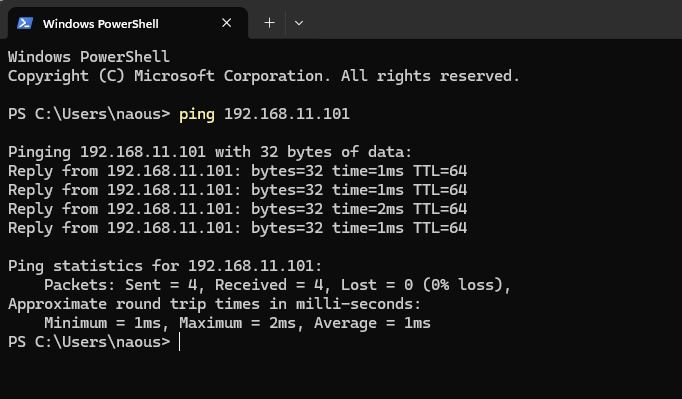
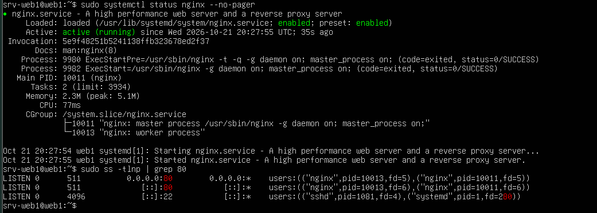
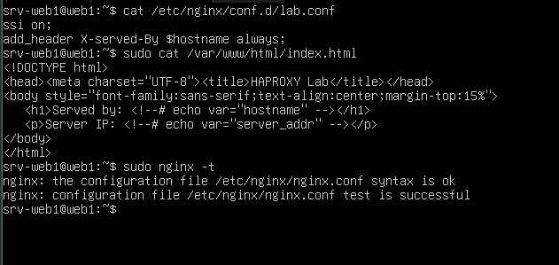
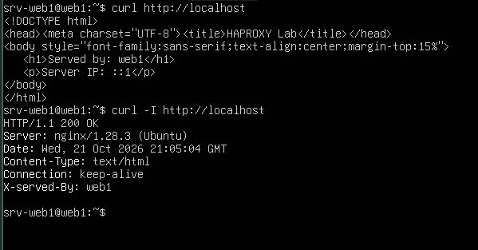
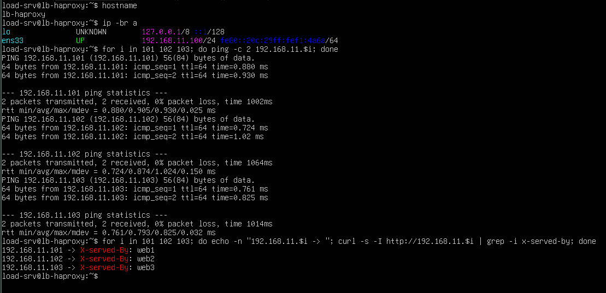
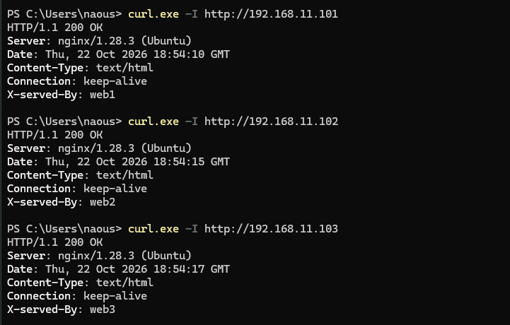

# 03 - Virtual Machine Setup

This document describes how the four virtual machines of the lab were created and configured: the load balancer (`lb-haproxy`) and the three web servers (`web1`, `web2`, `web3`). It covers the network configuration, the Nginx setup, the cloning procedure and the connectivity checks.

## 1. Virtual machine inventory

| VM | Role | OS | IP address | Software |
|---|---|---|---|---|
| `lb-haproxy` | Load balancer | Ubuntu Server LTS | 192.168.11.100 | HAProxy (installed in step 04) |
| `web1` | Web server 1 | Ubuntu Server LTS | 192.168.11.101 | Nginx |
| `web2` | Web server 2 (clone of `web1`) | Ubuntu Server LTS | 192.168.11.102 | Nginx |
| `web3` | Web server 3 (clone of `web1`) | Ubuntu Server LTS | 192.168.11.103 | Nginx |

Web server hardware: 1 GB RAM, 1 vCPU, thin-provisioned disk.


*Figure 1 - The lab virtual machines in VMware.*

## 2. Network configuration

- **VMware network mode:** Bridged. The VMs are placed directly on the physical network and reach the host PC and the internet like any other device.
- **Network:** `192.168.11.0/24`
- **Gateway:** `192.168.11.1`
- **Addressing:** static IP on every VM, so the HAProxy configuration never depends on DHCP leases.

All four VMs use a static IP configured with Netplan. Example for `web1` (the interface name may differ, check it with `ip -br a`):

```yaml
network:
  version: 2
  ethernets:
    ens33:
      dhcp4: false
      addresses:
        - 192.168.11.101/24
      routes:
        - to: default
          via: 192.168.11.1
      nameservers:
        addresses:
          - 192.168.11.1
          - 8.8.8.8
```

Cloud-init was told not to manage the network, so it cannot overwrite this file:

```bash
echo 'network: {config: disabled}' | sudo tee /etc/cloud/cloud.cfg.d/99-disable-network-config.cfg
```

The configuration is applied with `sudo netplan try`, which rolls back automatically if connectivity is lost.



*Figure 2 - The host PC reaches `web1` on its static IP.*

## 3. Web server setup (`web1`)

### 3.1 Nginx installation

```bash
sudo apt install -y nginx
systemctl status nginx --no-pager
sudo ss -tlnp | grep :80
```



*Figure 3 - Nginx is running and listening on port 80.*

### 3.2 Server identification

To see which server answers a request, each web server reports its own hostname. Two files make this possible, and both are stored in this repository under `configs/web/`.

`/etc/nginx/conf.d/lab.conf`:

```nginx
ssi on;
add_header X-Served-By $hostname always;
```

- `ssi on;` enables Server Side Includes so the page can contain values filled in by Nginx.
- `add_header X-Served-By $hostname always;` adds the server's hostname to every HTTP response.

`/var/www/html/index.html`:

```html
<!DOCTYPE html>
<html>
<head><meta charset="utf-8"><title>HAProxy Lab</title></head>
<body style="font-family:sans-serif;text-align:center;margin-top:15%">
  <h1>Served by: <!--# echo var="hostname" --></h1>
  <p>Server IP: <!--# echo var="server_addr" --></p>
</body>
</html>
```

Because the hostname is inserted automatically, the cloned servers need **no page changes**.



*Figure 4 - Nginx configuration files and a successful `nginx -t` test.*

### 3.3 Tests on `web1`

```bash
curl http://localhost
curl -I http://localhost
```



*Figure 5 - `curl` shows the page content and the `X-Served-By` header.*


*Figure 6 - The page displayed in a browser on the host PC.*

## 4. Cloning `web1` into `web2` and `web3`

`web1` was fully configured first, then shut down and cloned (full clone) twice. It stayed powered off until both clones had their own IP, to avoid an address conflict.

Each clone needs these changes (shown for `web2`; `web3` is identical with `web3` and `192.168.11.103`):

| Item | Why it must change | Command |
|---|---|---|
| Hostname | Identify the server in the test page | `sudo hostnamectl set-hostname web2` and `sudo sed -i 's/web1/web2/g' /etc/hosts` |
| machine-id | Must be unique per machine | `sudo rm -f /etc/machine-id /var/lib/dbus/machine-id`, `sudo systemd-machine-id-setup`, `sudo ln -sf /etc/machine-id /var/lib/dbus/machine-id` |
| SSH host keys | Avoid identical keys on several servers | `sudo rm /etc/ssh/ssh_host_*` and `sudo dpkg-reconfigure openssh-server` |
| IP address | Avoid an address conflict | `sudo sed -i 's/192.168.11.101/192.168.11.102/' /etc/netplan/50-cloud-init.yaml` then `sudo netplan try` |

## 5. Verification

### 5.1 From `lb-haproxy`

```bash
for i in 101 102 103; do ping -c 2 192.168.11.$i; done
for i in 101 102 103; do echo -n "192.168.11.$i -> "; curl -s -I http://192.168.11.$i | grep -i x-served-by; done
```

Expected result:

```
192.168.11.101 -> X-Served-By: web1
192.168.11.102 -> X-Served-By: web2
192.168.11.103 -> X-Served-By: web3
```



*Figure 7 - `lb-haproxy` reaches the three web servers, and each IP maps to the right server.*

### 5.2 From the host PC

```
curl -I http://192.168.11.101
curl -I http://192.168.11.102
curl -I http://192.168.11.103
```



*Figure 8 - The host PC reaches all three web servers.*

## 6. Lab versus production

| Aspect | This lab | Production |
|---|---|---|
| Server creation | One manual install, then cloning | Automated provisioning (Ansible, Terraform, images) |
| Page content | Static page showing the hostname | Real application deployed through a pipeline |
| Network config | Manual Netplan edits | Configuration management, DHCP reservations or DNS |
| Unique identifiers | Regenerated by hand after cloning | Handled automatically by the provisioning tool |
| Access | Password login | SSH keys, bastion host, centralized authentication |

## 7. Next step

- [04 - HAProxy configuration](04-haproxy-config.md)
