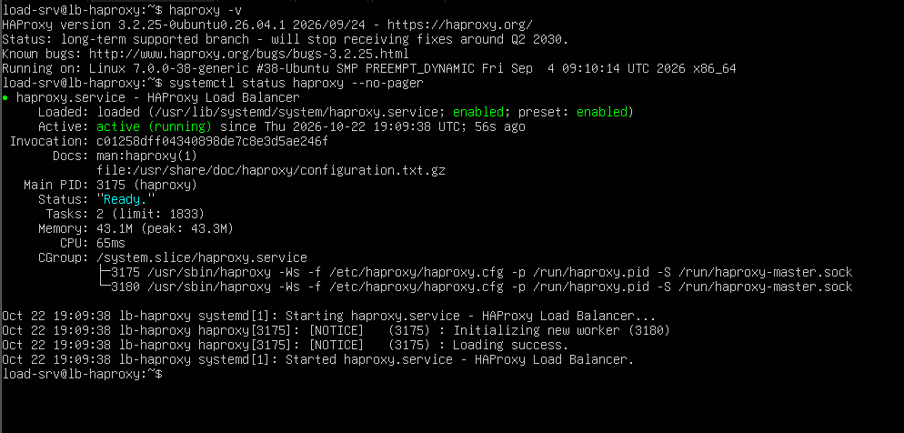
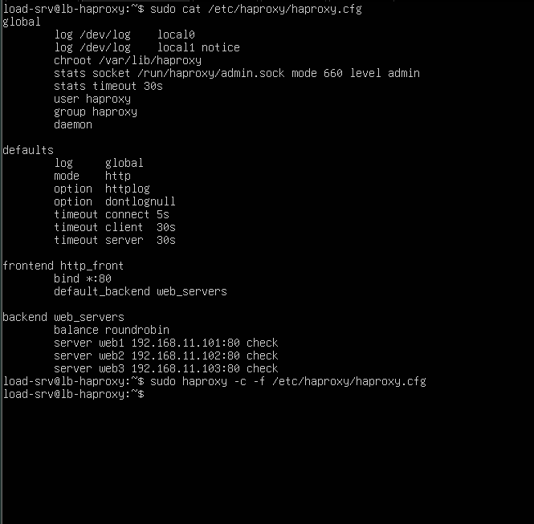
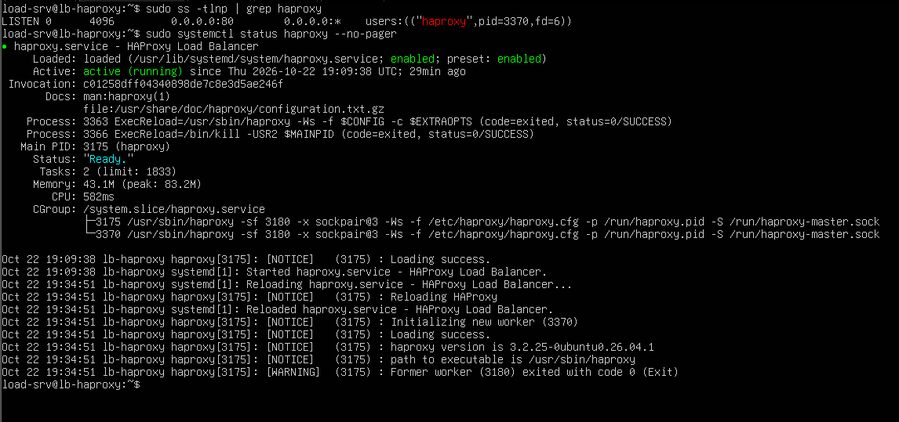
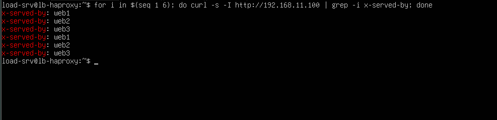
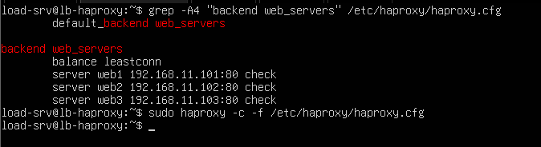
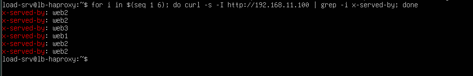
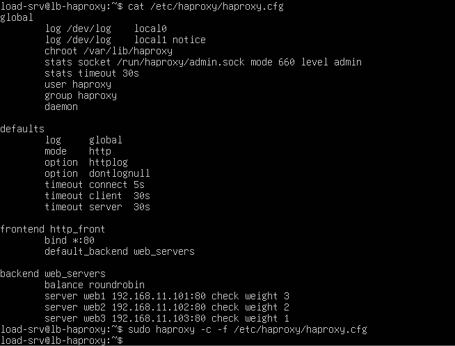
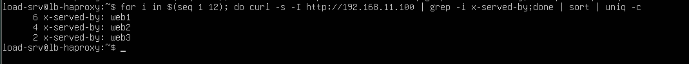

# 04 - HAProxy Configuration

This document covers the installation of HAProxy on `lb-haproxy`, a line-by-line explanation of its configuration, and the three balancing algorithms tested in the lab: Round Robin, Least Connections and Weighted Round Robin.

## 1. Installation

```bash
sudo apt update
sudo apt install -y haproxy
haproxy -v
systemctl status haproxy --no-pager
sudo cp /etc/haproxy/haproxy.cfg /etc/haproxy/haproxy.cfg.bak
```

| Command | Purpose |
|---|---|
| `apt update` | Refresh the list of available packages |
| `apt install -y haproxy` | Install HAProxy from Ubuntu's repositories |
| `haproxy -v` | Display the installed version |
| `systemctl status haproxy --no-pager` | Check that the service is running |
| `cp ... haproxy.cfg.bak` | Back up the default configuration before changing it |



*Figure 1 - HAProxy installed and running.*

## 2. Structure of the configuration file

The configuration lives in `/etc/haproxy/haproxy.cfg` and is made of four kinds of sections:

| Section | Role |
|---|---|
| `global` | Settings of the HAProxy process itself (user, logging, admin socket) |
| `defaults` | Default settings inherited by the frontends and backends that follow |
| `frontend` | Entry point: where HAProxy listens and where it sends traffic |
| `backend` | Pool of servers, with the balancing algorithm and health checks |

## 3. Round Robin configuration

Full file: [`configs/haproxy/haproxy-roundrobin.cfg`](../configs/haproxy/haproxy-roundrobin.cfg)

```haproxy
global
    log /dev/log local0
    log /dev/log local1 notice
    chroot /var/lib/haproxy
    stats socket /run/haproxy/admin.sock mode 660 level admin
    stats timeout 30s
    user haproxy
    group haproxy
    daemon

defaults
    log     global
    mode    http
    option  httplog
    option  dontlognull
    timeout connect 5s
    timeout client  30s
    timeout server  30s

frontend http_front
    bind *:80
    default_backend web_servers

backend web_servers
    balance roundrobin
    server web1 192.168.11.101:80 check
    server web2 192.168.11.102:80 check
    server web3 192.168.11.103:80 check
```

### 3.1 `global` section

| Line | Meaning |
|---|---|
| `log /dev/log local0` | Send logs to the system log socket, using the `local0` channel |
| `log /dev/log local1 notice` | Same, on `local1`, only for messages of level `notice` and above |
| `chroot /var/lib/haproxy` | Confine the process to this directory (security hardening) |
| `stats socket /run/haproxy/admin.sock mode 660 level admin` | Create a local control socket for runtime administration |
| `stats timeout 30s` | Time limit for commands sent through that socket |
| `user haproxy` / `group haproxy` | Drop root privileges after startup and run as the `haproxy` user |
| `daemon` | Run in the background |

### 3.2 `defaults` section

| Line | Meaning |
|---|---|
| `log global` | Use the logging settings defined in `global` |
| `mode http` | Work at layer 7: HAProxy understands HTTP requests, headers and URLs |
| `option httplog` | Write detailed HTTP logs |
| `option dontlognull` | Do not log empty connections (for example simple port probes) |
| `timeout connect 5s` | Maximum time to establish a connection to a backend server |
| `timeout client 30s` | Maximum inactivity time on the client side |
| `timeout server 30s` | Maximum time to wait for a backend server's response |

### 3.3 `frontend` section

| Line | Meaning |
|---|---|
| `frontend http_front` | Declare a frontend named `http_front` |
| `bind *:80` | Listen on port 80 on all addresses of the VM |
| `default_backend web_servers` | Send all traffic to the backend named `web_servers` |

### 3.4 `backend` section

| Line | Meaning |
|---|---|
| `backend web_servers` | Declare the server pool |
| `balance roundrobin` | Send requests to each server in turn |
| `server web1 192.168.11.101:80 check` | Declare a server (label, IP, port). `check` enables health checks |

### 3.5 Validating and applying a configuration

```bash
sudo haproxy -c -f /etc/haproxy/haproxy.cfg
sudo systemctl reload haproxy
sudo ss -tlnp | grep haproxy
systemctl status haproxy --no-pager
```

| Command | Purpose |
|---|---|
| `haproxy -c -f <file>` | Check the syntax of the configuration without applying it |
| `systemctl reload haproxy` | Apply the new configuration without dropping existing connections |
| `ss -tlnp \| grep haproxy` | Confirm HAProxy is listening (`-t` TCP, `-l` listening, `-n` numeric, `-p` process) |
| `systemctl status haproxy` | Confirm the service is active |



*Figure 2 - Round Robin configuration validated by `haproxy -c`.*



*Figure 3 - HAProxy listening on port 80, service active.*

### 3.6 Test

```bash
for i in $(seq 1 6); do curl -s -I http://192.168.11.100 | grep -i x-served-by; done
```

Each request returns the `X-Served-By` header set by the web servers. With Round Robin the servers answer in turn: `web1`, `web2`, `web3`, `web1`, `web2`, `web3`.



*Figure 4 - Requests are distributed in rotation.*

## 4. Least Connections

Full file: [`configs/haproxy/haproxy-leastconn.cfg`](../configs/haproxy/haproxy-leastconn.cfg)

Only one line changes in the backend:

```haproxy
backend web_servers
    balance leastconn
    server web1 192.168.11.101:80 check
    server web2 192.168.11.102:80 check
    server web3 192.168.11.103:80 check
```

`balance leastconn` sends each new request to the server that currently has the fewest active connections. It suits long or uneven connections (downloads, uploads, databases). With very short requests it behaves like Round Robin, so the test must keep some connections open.



*Figure 5 - Least Connections configuration validated.*

### 4.1 Test procedure

1. Create a 50 MB file on each web server: `sudo fallocate -l 50M /var/www/html/big.bin`
2. Start three slow downloads through HAProxy and record which server received each:

   ```bash
   for n in 1 2 3; do curl -s --limit-rate 20k -D /tmp/slow$n.txt -o /dev/null http://192.168.11.100/big.bin & done
   sleep 2
   grep -i x-served-by /tmp/slow*.txt
   ```

3. Stop two of the downloads (`kill %2 %3`), so that exactly one server stays busy.
4. Send six quick requests:

   ```bash
   for i in $(seq 1 6); do curl -s -I http://192.168.11.100 | grep -i x-served-by; done
   ```

**Result:** the busy server receives few or none of the quick requests, while the two idle servers share them. Round Robin would have sent a third of them to the busy server.



*Figure 6 - The server holding a slow connection is avoided.*

## 5. Weighted Round Robin

Full file: [`configs/haproxy/haproxy-weighted.cfg`](../configs/haproxy/haproxy-weighted.cfg)

```haproxy
backend web_servers
    balance roundrobin
    server web1 192.168.11.101:80 check weight 3
    server web2 192.168.11.102:80 check weight 2
    server web3 192.168.11.103:80 check weight 1
```

A server's `weight` defines its share of the traffic relative to the others (default `1`). With weights 3, 2 and 1, the expected shares are 50%, 33% and 17%.



*Figure 7 - Weighted Round Robin configuration validated.*

### 5.1 Test

```bash
for i in $(seq 1 12); do curl -s -I http://192.168.11.100 | grep -i x-served-by; done | sort | uniq -c
```

`sort` groups identical lines and `uniq -c` counts them. Expected result for 12 requests:

```
      6 X-Served-By: web1
      4 X-Served-By: web2
      2 X-Served-By: web3
```



*Figure 8 - The distribution follows the 3:2:1 ratio.*

## 6. Choosing an algorithm

| Algorithm | Directive | Best suited for |
|---|---|---|
| Round Robin | `balance roundrobin` | Short, similar requests on equal servers |
| Weighted Round Robin | `balance roundrobin` + `weight N` | Servers of different capacity |
| Least Connections | `balance leastconn` | Long or uneven connections |

## 7. Lab versus production

| Aspect | This lab | Production |
|---|---|---|
| Traffic | A few requests sent by hand | Thousands of simultaneous clients |
| Weights | Chosen to demonstrate the effect | Based on measured server capacity |
| Algorithm choice | Compared on purpose | Chosen per service and checked with metrics |
| Configuration changes | Edited by hand on the VM | Version-controlled, tested, then deployed automatically |

## 8. Next step

- [05 - Testing and verifying the distribution](05-testing.md)
