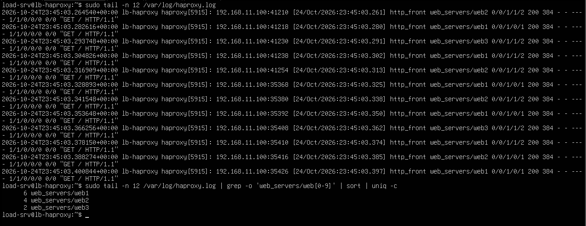
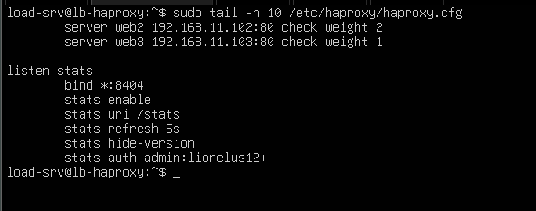
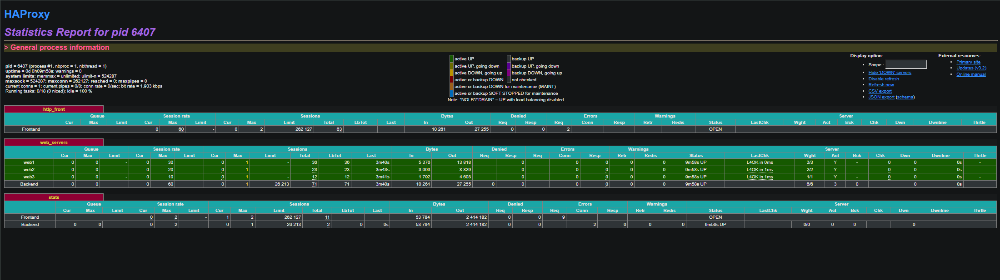

# 05 - Testing and Verifying the Distribution

This document shows how to verify that HAProxy really distributes requests between the three web servers. The same result is checked from three independent points of view: the client, the HAProxy logs and the HAProxy statistics page.

## 1. Why verify from several angles

| Point of view | Source of the information | What it proves |
|---|---|---|
| Client | The `X-Served-By` header added by Nginx | What the web servers say about themselves |
| HAProxy logs | `/var/log/haproxy.log` | Where HAProxy says it sent each request |
| Statistics page | HAProxy dashboard on port 8404 | Live counters, weights and server health |

When the three agree, the distribution is confirmed.

## 2. Client side: the `X-Served-By` header

Each web server adds its hostname to every response (see [03 - VM setup](03-vm-setup.md)). Six requests sent to the load balancer:

```bash
for i in $(seq 1 6); do curl -s -I http://192.168.11.100 | grep -i x-served-by; done
```

Counting the requests per server:

```bash
for i in $(seq 1 12); do curl -s -I http://192.168.11.100 | grep -i x-served-by; done | sort | uniq -c
```

| Command part | Purpose |
|---|---|
| `curl -s -I` | Fetch only the response headers, silently |
| `grep -i x-served-by` | Keep the header that names the server |
| `sort \| uniq -c` | Group identical lines and count them |

## 3. HAProxy side: the logs

Generate some traffic, then read the log:

```bash
for i in $(seq 1 12); do curl -s -o /dev/null http://192.168.11.100; done
sudo tail -n 12 /var/log/haproxy.log
```

Example of a log line (illustrative):

```
haproxy[1234]: 192.168.11.50:51234 [24/Oct/2026:14:02:11.123] http_front web_servers/web1 0/0/1/1/2 200 612 - - ---- 1/1/0/0/0 0/0 "GET / HTTP/1.1"
```

| Part | Meaning |
|---|---|
| `192.168.11.50:51234` | Client IP and port |
| `[24/Oct/2026:14:02:11.123]` | Time the request was accepted |
| `http_front` | Frontend that received the request |
| `web_servers/web1` | Backend and server chosen by HAProxy |
| `0/0/1/1/2` | Timers in milliseconds (queue, connect, response, total) |
| `200` | HTTP status code returned |
| `612` | Bytes sent to the client |
| `1/1/0/0/0` | Connection counters |
| `"GET / HTTP/1.1"` | The request |

Counting the requests per server from the log:

```bash
sudo tail -n 12 /var/log/haproxy.log | grep -o 'web_servers/web[0-9]' | sort | uniq -c
```



*Figure 1 - HAProxy logs and the number of requests per server.*

## 4. The statistics page

### 4.1 Configuration

Full file: [`configs/haproxy/haproxy-healthcheck.cfg`](../configs/haproxy/haproxy-healthcheck.cfg)

```haproxy
listen stats
    bind *:8404
    stats enable
    stats uri /stats
    stats refresh 5s
    stats hide-version
    stats auth admin:CHANGE_ME
```

| Line | Meaning |
|---|---|
| `listen stats` | A `listen` section combines a frontend and a backend in one block |
| `bind *:8404` | Listen on port 8404, separate from the load-balanced traffic |
| `stats enable` | Enable the statistics page |
| `stats uri /stats` | URL path of the page |
| `stats refresh 5s` | Automatic refresh every 5 seconds |
| `stats hide-version` | Do not display the HAProxy version |
| `stats auth admin:CHANGE_ME` | Require a login (replace the placeholder with your own lab password) |



*Figure 2 - Statistics section added and validated. HAProxy listens on ports 80 and 8404.*

### 4.2 Reading the dashboard

The dashboard is available at `http://192.168.11.100:8404/stats`. After sending 60 requests, the `web_servers` table gives the distribution per server.

| Column | What it shows |
|---|---|
| Sessions - Total | Requests handled by each server since the last reload |
| Weight | Weight configured for each server |
| Status | `UP` (green) or `DOWN` (red) |
| LastChk | Result of the last health check |
| Bytes - Out | Data sent back to clients |
| Sessions - Cur | Connections open right now |



*Figure 3 - Distribution per server in the `web_servers` backend.*

## 5. Lab versus production

| Aspect | This lab | Production |
|---|---|---|
| Statistics page | Open on the whole network, plain HTTP, basic password | Reachable only from a management network or localhost, with HTTPS |
| Observation | Manual `curl` loops and `grep` | Metrics collected continuously (Prometheus, Grafana) with alerts |
| Logs | One local file | Centralized log collection and search |

## 6. Next step

- [06 - Health checks and failover](06-health-checks-failover.md)
