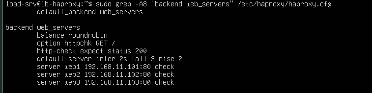
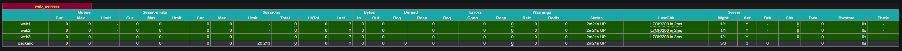
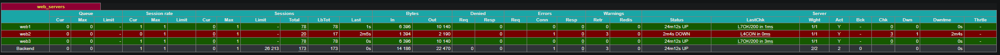
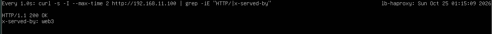
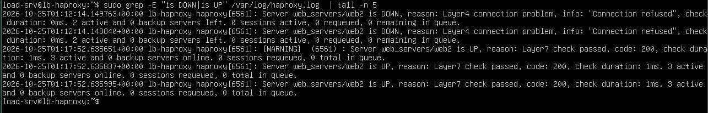
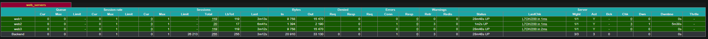

# 06 - Health Checks and Failover

This document explains how HAProxy detects a failed web server, how the detection is tuned, and what happens to client requests when a server goes down and comes back.

## 1. TCP check versus HTTP check

| Check type | Configuration | What it verifies | `LastChk` value |
|---|---|---|---|
| TCP (layer 4) | `check` alone | The server's port accepts a connection | `L4OK` |
| HTTP (layer 7) | `check` + `option httpchk` | The server answers a real HTTP request with the expected status | `L7OK/200` |

A TCP check can report a server as healthy while its application is broken (the port is open but the pages return errors). An HTTP check detects that situation.

## 2. Configuration

Full file: [`configs/haproxy/haproxy-healthcheck.cfg`](../configs/haproxy/haproxy-healthcheck.cfg)

For this test the weights were removed, so that two remaining servers share the traffic equally and the failure is easy to read.

```haproxy
backend web_servers
    balance roundrobin
    option httpchk GET /
    http-check expect status 200
    default-server inter 2s fall 3 rise 2
    server web1 192.168.11.101:80 check
    server web2 192.168.11.102:80 check
    server web3 192.168.11.103:80 check
```

| Line | Meaning |
|---|---|
| `option httpchk GET /` | Send a real `GET /` request to each server instead of a simple TCP connection |
| `http-check expect status 200` | The server is healthy only if it answers with HTTP status 200 |
| `default-server inter 2s fall 3 rise 2` | Default check parameters for every server below |
| `server ... check` | Enable health checking on the server |

| Parameter | Meaning | Effect in this lab |
|---|---|---|
| `inter 2s` | Interval between two checks | One check every 2 seconds |
| `fall 3` | Failed checks in a row before the server is marked `DOWN` | Detection in about 3 x 2 s = 6 s |
| `rise 2` | Successful checks in a row before the server is marked `UP` again | Recovery in about 2 x 2 s = 4 s |

Requiring several consecutive results avoids "flapping", where a single failed or successful check would put a server in and out of service.



*Figure 1 - Backend with HTTP health checks, validated by `haproxy -c`.*



*Figure 2 - The dashboard shows `L7OK/200` for each server.*

## 3. Failure test: stopping Nginx on `web2`

### 3.1 Preparation

A live monitor on `lb-haproxy` shows the HTTP status and the server answering each second:

```bash
watch -n 1 'curl -s -I --max-time 2 http://192.168.11.100 | grep -iE "HTTP/|x-served-by"'
```

The statistics page is kept open in a browser.

### 3.2 Failure

On `web2`:

```bash
sudo systemctl stop nginx
```

| Time | Dashboard | Monitor |
|---|---|---|
| 0 to about 6 s | `web2` turns yellow while checks fail | Some requests may return `503`: HAProxy still sends requests to the dead server |
| After about 6 s | `web2` turns red (`DOWN`), `LastChk` shows a connection problem | Only `web1` and `web3` answer, always with `200 OK` |

The short period of possible `503` answers is the **detection delay**. It can be reduced with a smaller `inter` or `fall`, at the cost of more check traffic and a higher risk of false alarms.



*Figure 3 - `web2` is marked `DOWN`.*



*Figure 4 - Only `web1` and `web3` answer client requests.*

### 3.3 Logs

```bash
sudo grep -E "is DOWN|is UP" /var/log/haproxy.log | tail -n 5
```

HAProxy logs each status change with the server name, the reason (for example `Layer4 connection problem`, `Connection refused`) and the number of servers still active.

### 3.4 Recovery

On `web2`:

```bash
sudo systemctl start nginx
```

After about 4 seconds, `web2` is marked `UP` again and receives requests in its turn.



*Figure 5 - The log shows `web2 is DOWN` followed by `web2 is UP`.*



*Figure 6 - All three servers are green again.*

## 4. Findings

- **Fault tolerance:** clients keep receiving valid answers while one backend server is down.
- **Automatic detection and recovery:** no configuration change and no HAProxy restart is needed.
- **Detection delay:** a few requests can fail before the server is marked `DOWN`.
- **Remaining single point of failure:** `lb-haproxy` itself. If it fails, the whole service is unavailable.

## 5. Lab versus production

| Aspect | This lab | Production |
|---|---|---|
| Load balancer | One HAProxy VM | Two or more HAProxy nodes with Keepalived and a virtual IP |
| Health check | `GET /` on the home page | A dedicated health endpoint that tests the application and its dependencies |
| Failure handling | Manual observation | Alerts and automatic remediation |
| Retries | Default behavior | `retries` and `option redispatch` tuned to retry a request on another server |
| Failure scope | One service stopped | Network, host, zone and dependency failures all tested |

## 6. Next step

- [07 - Troubleshooting](07-troubleshooting.md)
