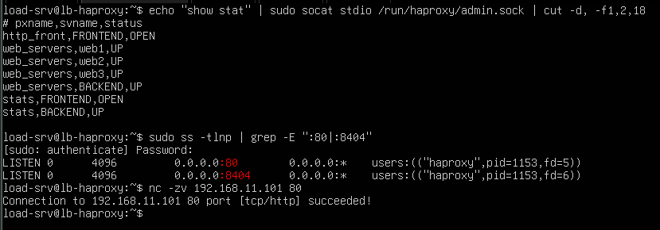

# 07 - Troubleshooting

This document gives a method and a set of commands to diagnose problems in the HAProxy lab. The principle is to work from the outside in, one layer at a time, and to stop at the first layer that fails.

## 1. Reading the symptom

| What the client sees | Most likely meaning |
|---|---|
| Connection refused | HAProxy is not listening on that port (service stopped, wrong port, configuration error) |
| Timeout (no answer) | The network is blocked: wrong IP, firewall, VM powered off |
| `503 Service Unavailable` | HAProxy works, but no healthy server is available in the backend |
| `502 Bad Gateway` | A backend server sent an invalid answer or closed the connection abruptly |
| `504 Gateway Timeout` | A backend server accepted the request but was too slow (`timeout server` exceeded) |
| Answers from the wrong server, or an unexpected distribution | Wrong algorithm, wrong weights or an incorrect server list |

## 2. The diagnostic ladder

### 2.1 Is HAProxy running?

```bash
systemctl status haproxy --no-pager
sudo journalctl -u haproxy -n 30 --no-pager
```

`journalctl -u haproxy -n 30` shows the last 30 messages of the service. Startup and configuration errors appear here.

### 2.2 Is the configuration valid?

```bash
sudo haproxy -c -f /etc/haproxy/haproxy.cfg
```

The command names the file and the line of each syntax error.

### 2.3 Is HAProxy listening, and is the port free?

```bash
sudo ss -tlnp | grep -E ":80|:8404"
```

`haproxy` must appear on port 80 (and 8404 for the statistics page). If another program holds the port, HAProxy cannot start.

### 2.4 Can `lb-haproxy` reach each web server?

```bash
ping -c 2 192.168.11.101
nc -zv 192.168.11.101 80
curl -I http://192.168.11.101
```

| Test | Failure means |
|---|---|
| `ping` | The network path is broken (wrong IP, VM off, network problem) |
| `nc -zv ... 80` | Ping works but nothing listens on port 80, or a firewall blocks it |
| `curl -I` | The port is open but the application is broken |

### 2.5 What does HAProxy think of each server?

```bash
sudo apt install -y socat
echo "show stat" | sudo socat stdio /run/haproxy/admin.sock | cut -d, -f1,2,18
```

- `socat stdio /run/haproxy/admin.sock` connects to the control socket declared in the `global` section.
- `show stat` dumps the statistics as CSV.
- `cut -d, -f1,2,18` keeps the section name, the server name and the status (`UP`, `DOWN`, ...). It is the dashboard in text form, usable over SSH.

### 2.6 What do the HAProxy logs say?

```bash
sudo tail -n 20 /var/log/haproxy.log
sudo grep -E "is DOWN|is UP" /var/log/haproxy.log | tail -n 5
```

### 2.7 What does the backend server say?

On the web server:

```bash
sudo tail -n 20 /var/log/nginx/access.log
sudo tail -n 20 /var/log/nginx/error.log
systemctl status nginx --no-pager
```

### 2.8 From the client side

```bash
curl -v http://192.168.11.100
ip -br a
ip route
sudo ufw status
```

| Command | Purpose |
|---|---|
| `curl -v` | Show the connection steps, the request and the full response headers |
| `ip -br a` | Confirm the address of the machine |
| `ip route` | Confirm the default gateway |
| `ufw status` | Show whether the Ubuntu firewall is active (inactive by default) |

### 2.9 Last resort: capture packets

```bash
sudo tcpdump -i any -n port 80
```

`tcpdump` prints every packet on port 80 in real time (`-n` disables name resolution). It shows whether a request reaches the machine at all. Stop it with `Ctrl+C`.



*Figure 1 - Output of the diagnostic commands on a healthy lab. This is the reference to compare with when something breaks.*

## 3. Quick reference

| Question | Command |
|---|---|
| Is the service running? | `systemctl status haproxy` |
| Why did it fail to start? | `sudo journalctl -u haproxy -n 30` |
| Is the config valid? | `sudo haproxy -c -f /etc/haproxy/haproxy.cfg` |
| Is it listening? | `sudo ss -tlnp \| grep haproxy` |
| Is a backend reachable? | `nc -zv <ip> 80` and `curl -I http://<ip>` |
| Status of each server | `echo "show stat" \| sudo socat stdio /run/haproxy/admin.sock \| cut -d, -f1,2,18` |
| Which server got each request? | `sudo tail /var/log/haproxy.log` |
| What happens on the wire? | `sudo tcpdump -i any -n port 80` |

## 4. Lab versus production

| Aspect | This lab | Production |
|---|---|---|
| Diagnosis | Manual commands on each VM | Central monitoring, dashboards and alerts |
| Logs | Local files read with `tail` and `grep` | Centralized and searchable, with retention |
| Changes | Edited directly on the server | Validated in a test environment, then deployed through a pipeline |
| Packet capture | `tcpdump` when needed | Restricted, audited and used sparingly |

## 5. Next step

- [08 - Exercises](08-exercises.md)
