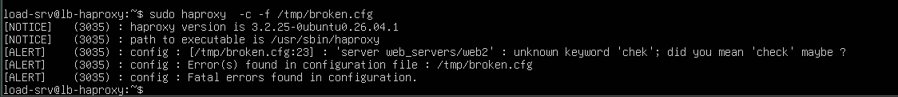
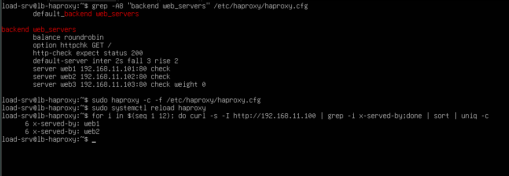
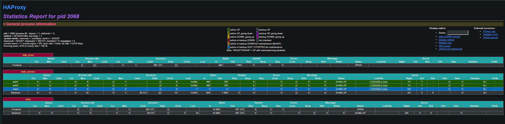
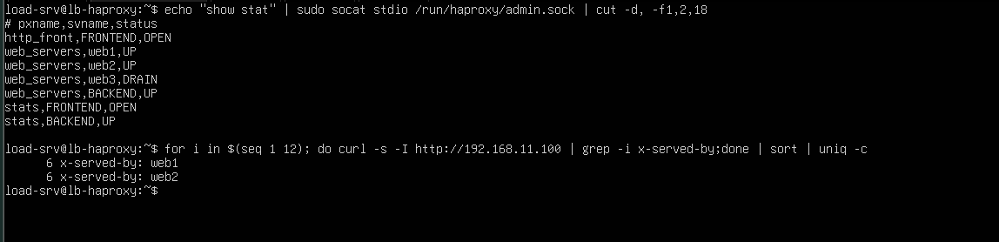
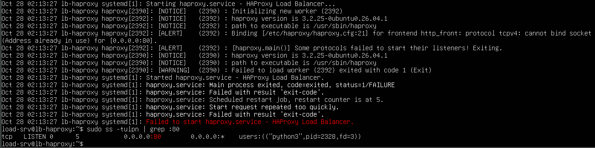
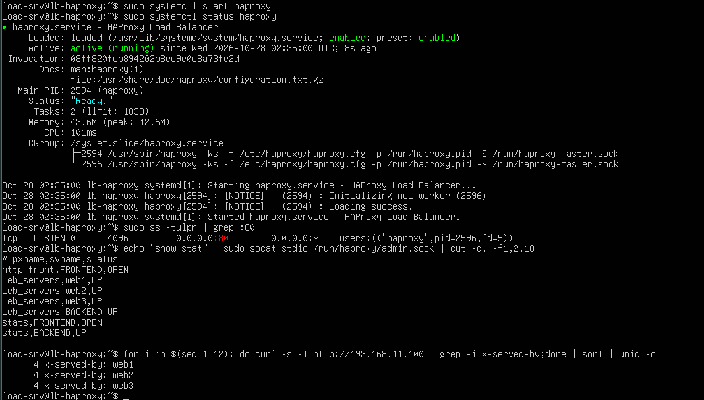
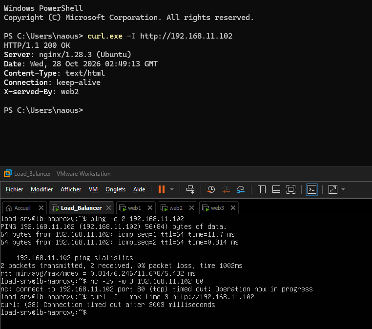
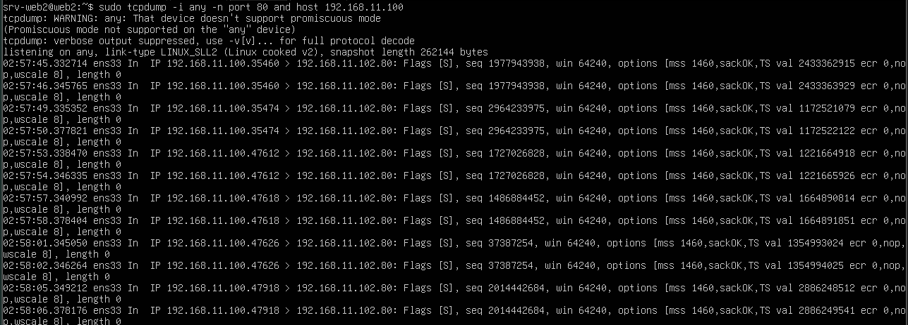
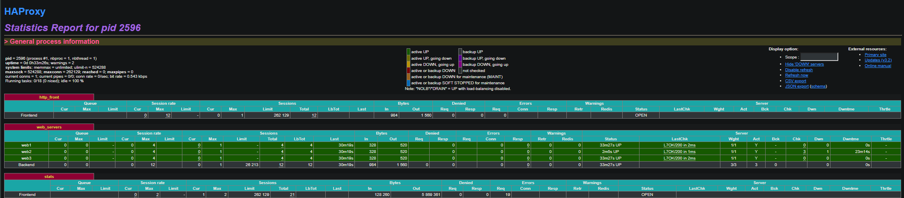
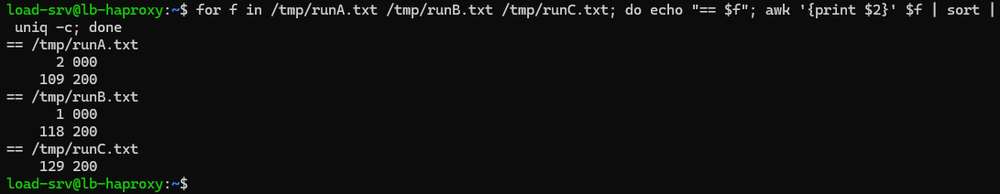

# 08 - Exercises

This document contains five hands-on exercises that practise the diagnostic method from [07 - Troubleshooting](07-troubleshooting.md). Each exercise describes an incident, the tasks, the diagnosis path and the lessons learned.

Method for every exercise: observe the symptom, identify the layer (client, HAProxy, network, backend), confirm with a command, then fix and verify.

| # | Topic | Main skill |
|---|---|---|
| 1 | Broken configuration | Reading HAProxy error messages |
| 2 | Weight 0 and drain mode | Predicting behavior, planned maintenance |
| 3 | HAProxy will not start | Port conflict diagnosis |
| 4 | Server unreachable from the load balancer only | Timeout versus refused, firewall diagnosis |
| 5 | Tuning failure detection | Measuring the effect of health check and retry settings |

## Exercise 1: Fix a broken configuration

### Scenario

After an edit, the configuration no longer works. The faulty file is checked in `/tmp`, so the running service is never touched.

```bash
cat > /tmp/broken.cfg <<'EOF'
global
    log /dev/log local0
    user haproxy
    group haproxy

defaults
    log     global
    mode    http
    option  httplog
    timeout connect 5s
    timeout client  30s
    timeout server  30s

frontend http_front
    bind *:80
    default_backend web_server

backend web_servers
    balance roudrobin
    option httpchk GET /
    http-check expect status 200
    server web1 192.168.11.101:80 check
    server web2 192.168.11.102:80 chek
    server web3 192.168.11.103:80 check
EOF

sudo haproxy -c -f /tmp/broken.cfg
```

### Diagnosis and solution

| Line | Faulty text | Fix | Cause |
|---|---|---|---|
| 16 | `default_backend web_server` | `default_backend web_servers` | The frontend refers to a backend by name, and the name must match exactly |
| 19 | `balance roudrobin` | `balance roundrobin` | Unknown algorithm name |
| 23 | `... chek` | `... check` | Unknown keyword on a `server` line |

How to read the messages:

- `[ALERT]` is a fatal error. `[WARNING]` does not block startup.
- `parsing [file:line]` gives the exact location.
- Errors about names that do not match (such as `default_backend`) are detected after the whole file is read and may have no line number.
- Fixing one error can reveal another, so the check is repeated until it passes.
- On Ubuntu, `systemctl reload haproxy` checks the configuration first. If it is invalid, the old configuration keeps running.



*Figure 1 - Errors reported by `haproxy -c`.*

## Exercise 2: Weight 0 and drain mode

### Scenario

The weight of `web3` is set to 0 while the other servers keep the default weight.

```haproxy
server web3 192.168.11.103:80 check weight 0
```

### Predictions and results

| Question | Result |
|---|---|
| Distribution of 12 requests | 6 for `web1`, 6 for `web2`, none for `web3` |
| Status of `web3` | Not `DOWN`: the dashboard shows it in the blue colour used for servers set aside for maintenance (drain) |

A weight of 0 does not mean the server failed. Health checks keep passing, the server stays healthy, and it only stops receiving **new** requests. Requests already in progress finish normally.



*Figure 2 - `web3` receives no requests.*



*Figure 3 - `web3` is displayed as set aside, not as down.*

### Planned maintenance procedure

1. Put the server in drain mode (new users go to the other servers).
2. Wait until its active connections reach zero.
3. Update or reboot the server.
4. Put it back in rotation.

### Drain through the runtime API

The admin socket declared in the `global` section allows changes without editing the file:

```bash
sudo apt install -y socat
echo "set server web_servers/web3 state drain" | sudo socat stdio /run/haproxy/admin.sock
echo "show stat" | sudo socat stdio /run/haproxy/admin.sock | cut -d, -f1,2,18
echo "set server web_servers/web3 state ready" | sudo socat stdio /run/haproxy/admin.sock
```

| State | Effect |
|---|---|
| `drain` | No new requests; existing ones finish; health checks continue |
| `ready` | Normal operation |
| `maint` | Server disabled, health checks stop |

Runtime changes are held in memory only. A reload or restart of HAProxy erases them, so a lasting change must also be written in the configuration file.



*Figure 4 - `web3` in `DRAIN` state and the resulting distribution.*

## Exercise 3: HAProxy will not start

### Scenario

The load balancer is down after a maintenance window. The incident is simulated by starting another service on port 80:

```bash
mkdir -p /tmp/legacy
sudo systemctl stop haproxy
sudo systemd-run --unit=legacy-web python3 -m http.server 80 --directory /tmp/legacy
sudo systemctl start haproxy
```

### Diagnosis path

| Question | Command | Finding |
|---|---|---|
| Is the service running? | `systemctl status haproxy` | Failed, with "start request repeated too quickly" |
| What is the real error? | `sudo journalctl -u haproxy -n 30 --no-pager` | `cannot bind socket (Address already in use) [0.0.0.0:80]` |
| What holds port 80? | `sudo ss -tlnp \| grep :80` | A `python3` process |
| Which service started it? | `systemctl status <pid>` | `legacy-web.service` |
| What do clients see? | Browser on `http://192.168.11.100` | A directory listing from the wrong program |

"Start request repeated too quickly" is a consequence, not the cause: the service restarts automatically on failure, and systemd gives up after several quick failures (start limit). The real cause is in the journal.

### Fix

```bash
sudo systemctl stop legacy-web
sudo systemctl reset-failed haproxy
sudo systemctl start haproxy
```

`reset-failed` clears the start limit state. Without it, systemd may refuse to start HAProxy even though the port is free.

### Lessons

- Do not move the production service to make room for an unknown one. Find out first whether the other service is needed. If it is, move that one to another port.
- Clients received a normal `200` page from the wrong program. Monitoring that only checks "does port 80 answer?" would not have detected the incident.



*Figure 5 - The bind error and the process holding port 80.*



*Figure 6 - HAProxy active, three servers up, requests distributed.*

## Exercise 4: Unreachable from the load balancer only

### Scenario

`web2` is red in the dashboard, yet the VM is running, Nginx is running, and the page works from the host PC. The incident is simulated on `web2`:

```bash
sudo ufw allow 22/tcp
sudo ufw deny from 192.168.11.100 to any port 80 proto tcp
sudo ufw allow 80/tcp
sudo ufw --force enable
```

### Diagnosis path

| Test | Result | Meaning |
|---|---|---|
| Dashboard `LastChk` | `L4TOUT` | Layer 4 timeout: no answer at all |
| `ping` from the load balancer | Answers | The network path works |
| `nc -zv -w 3 192.168.11.102 80` from the load balancer | No answer | Port 80 unreachable from that machine |
| `curl -I --max-time 3` from the load balancer | No answer | Same |
| `curl -I` from the host PC | Answers | The server and Nginx are healthy |
| Nginx access log | Nothing from the load balancer | Requests never reach Nginx |
| `tcpdump` on `web2` | Packets from `192.168.11.100` arrive, nothing leaves | Packets are dropped on the machine |
| `ufw status` | Deny rule for `192.168.11.100` on port 80 | Cause found |

### Refused versus timeout

| What is seen | Meaning | Typical causes | Example in this lab |
|---|---|---|---|
| Connection refused (`L4CON`) | The machine answered "nothing listens here" | Service stopped, wrong port, a firewall rule that rejects | Nginx stopped |
| Timeout (`L4TOUT`) | No answer: packets silently lost | Firewall that drops, wrong IP, machine off, routing problem | This exercise |
| Wrong status (`L7STS`) | The port is open, the application misbehaves | Application error, permissions | Unreadable page |

A firewall acts in the kernel, before the packet reaches the application. If `tcpdump` shows packets but the application log is empty, suspect a firewall. The firewall rules can also be listed with `sudo iptables -S` or `sudo nft list ruleset`.

### Fix

```bash
sudo ufw delete deny from 192.168.11.100 to any port 80 proto tcp
sudo ufw --force reset
```

The first command removes the faulty rule. The second returns `web2` to the lab baseline (no firewall), identical to `web1` and `web3`.

### Production rule

Rules are evaluated in order and the first match wins, which is why the `deny` added first beat the broader `allow 80/tcp`. In production, a backend server should accept web traffic only from the load balancer:

```bash
sudo ufw allow from 192.168.11.100 to any port 80 proto tcp
```

Clients then have to go through HAProxy and cannot bypass it.



*Figure 7 - The load balancer gets no answer while the host PC does.*



*Figure 8 - Packets arrive on `web2` without any reply; the deny rule is found.*



*Figure 9 - All three servers are up again.*

## Exercise 5: Tuning failure detection

### Goal

Measure the effect of health check timing and retries on failed requests when a server stops.

### Measuring tool

The script `scripts/measure.sh` sends about 4 to 5 requests per second for 30 seconds and logs the time and HTTP status of each request. A failed request is logged as `000` when curl receives no usable HTTP response.

```bash
#!/bin/bash
# Sends ~5 requests/second for 30 seconds and logs time + HTTP status code
end=$((SECONDS+30))
while [ $SECONDS -lt $end ]; do
  echo "$(date +%T.%3N) $(curl -s -o /dev/null -w '%{http_code}' --max-time 2 http://192.168.11.100)"
  sleep 0.2
done
```

Procedure for each run: start the script with `~/measure.sh | tee /tmp/runX.txt`, stop Nginx on `web2` about 5 seconds later, restart it when the script ends, then list the failed requests:

```bash
grep -vc ' 200$' /tmp/runX.txt
grep -v ' 200$' /tmp/runX.txt
sudo grep -E "WARNING.*web2 is (DOWN|UP)" /var/log/haproxy.log | cut -c1-120
```

### Configurations compared

| Run | Settings |
|---|---|
| A | `default-server inter 2s fall 3 rise 2`, no retries |
| B | `default-server inter 500ms fall 2 rise 2`, no retries |
| C | `default-server inter 2s fall 3 rise 2` with `retries 3` and `option redispatch` |

| Line | Meaning |
|---|---|
| `inter 2s` | One health check every 2 seconds |
| `fall 3` | Three failed checks in a row before the server is marked down |
| `rise 2` | Two successful checks in a row before it is marked up again |
| `retries 3` | Retry a failed connection up to three times |
| `option redispatch` | On the last retry, send the request to another server |

### Results

| Run | Requests | Failed requests | First failure | `web2 is DOWN` logged | From first failure to DOWN |
|---|---|---|---|---|---|
| A | 111 | 2 | 03:23:18.897 | 03:23:22.514 | about 3.6 s |
| B | 119 | 1 | 03:30:08.956 | 03:30:09.272 | about 0.3 s |
| C | 129 | 0 | none | 03:34:48.646 | not applicable |

### Analysis

- In Run A, requests sent to `web2` after it stopped and before HAProxy marked it down failed.
- In Run B, detection was faster, so the failure window was much shorter.
- In Run C, detection was as slow as in Run A, but no request failed: connections refused by `web2` were retried on another server.
- The counts are small (about 4 requests per second, one run each), so the difference between A and B is only indicative. The clearest result is the zero failures of Run C.
- The `DOWN` and `UP` events show a different HAProxy process ID for each run, because each configuration change was applied with a reload.

### Risks and choice

An `inter` as low as 500 ms multiplies the health check traffic and can cause flapping: a server that is briefly slow fails a check, and two failures in a row remove it from service for no good reason.

The configuration kept for the lab combines moderate detection with retries (Run C). It protects clients during the detection window whatever its length. Full file: [`configs/haproxy/haproxy-final.cfg`](../configs/haproxy/haproxy-final.cfg)

```haproxy
backend web_servers
    balance roundrobin
    retries 3
    option redispatch
    option httpchk GET /
    http-check expect status 200
    default-server inter 2s fall 3 rise 2
    server web1 192.168.11.101:80 check
    server web2 192.168.11.102:80 check
    server web3 192.168.11.103:80 check
```



*Figure 10 - Failed requests of each run and the DOWN and UP events of `web2`.*

## Summary of lessons

| Lesson | Exercise |
|---|---|
| Read the error message: file, line, keyword | 1 |
| A server with weight 0 is healthy but receives no new requests, which is the basis of a graceful drain | 2 |
| A generic service message hides the real cause, which is in the journal | 3 |
| Refused means "nothing listens", timeout means "packets lost" | 4 |
| Detection speed and retries are complementary, and each has a cost | 5 |

## Lab versus production

| Aspect | This lab | Production |
|---|---|---|
| Incidents | Simulated by hand | Real, often without a clear cause |
| Diagnosis | Manual commands | Monitoring, alerting and centralized logs |
| Firewall | Disabled by default | Enabled, with rules that allow only the load balancer to reach the backends |
| Tuning | Measured on a small sample | Measured under real load, with metrics over time |

## Next step

- [09 - Jury scenario](09-jury-scenario.md)
